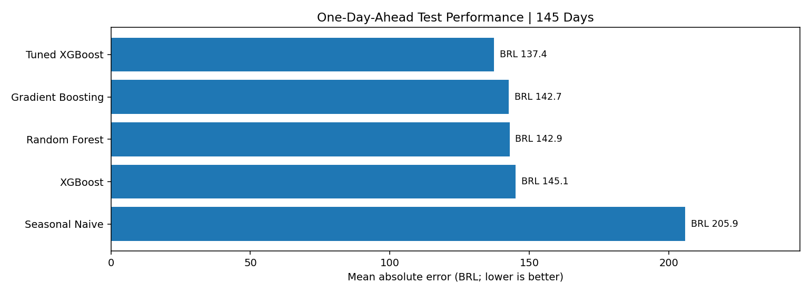
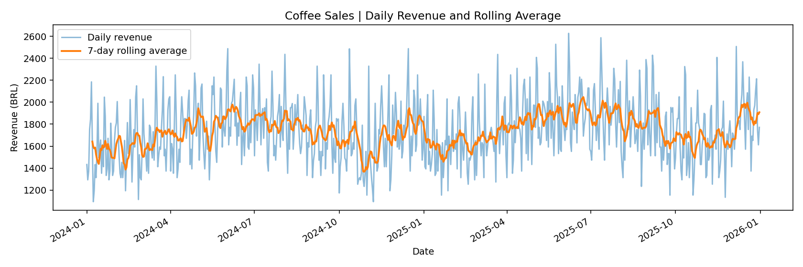

# Retail Revenue Forecasting — Daily Coffee Sales

A compact, portfolio-ready time-series forecasting project in Python, based on a **synthetic** daily coffee-sales dataset (2024–2025, 731 records). The goal is to predict daily revenue and demonstrate end-to-end forecasting methodology.

## Results preview

**One-day-ahead holdout** (145 daily observations; scores from a locally reproduced run, subject to dependency versions):

| Model | MAE (BRL) |
|---|---:|
| XGBoost (tuned) | 137.43 |
| Gradient Boosting | 142.69 |
| Random Forest | 142.95 |
| XGBoost (default experiment) | 145.10 |
| Seasonal-naive baseline | 205.89 |





These figures are descriptive and one-day-ahead evaluation results; they **do not** establish accuracy for a 30-day recursive forecast.

## What the notebook covers

1. Data ingestion from **CSV** (default) or **PostgreSQL** (optional)
2. Data quality checks and exploratory data analysis
3. Lag, calendar, and rolling-mean feature engineering
4. Chronological 80/20 train/test split
5. Seasonal-naive benchmark versus Random Forest, Gradient Boosting, and XGBoost
6. XGBoost tuning with `RandomizedSearchCV` and `TimeSeriesSplit`
7. Configurable multi-step recursive forecasting using `Skforecast`

**Prediction target:** `revenue = unit_price × units_sold` (Brazilian reais per day).

## Quick start

```bash
python3 -m venv .venv
source .venv/bin/activate
pip install -r requirements.txt
jupyter lab
```

Open `retail_revenue_forecasting.ipynb`, keep `DATA_SOURCE=csv` (default), and run the cells in order. The included `demanda_cafe_diaria_2024_2025.csv` must remain in the same directory as the notebook.

### PostgreSQL option

Create the project database and import the CSV with the included `setup_database.sql`. From the repository root (where the CSV is located):

```bash
psql -h localhost -U postgres -d postgres -f setup_database.sql
```

The script creates `coofee_sales` if necessary, creates `public.demanda_dia` with a composite primary key (`data`, `produto`), imports the CSV with `\copy`, and runs basic validation queries. It uses **psql-specific commands** and assumes the connection role has permission to create the database when needed. Re-running it skips existing records rather than duplicating them.

Create a local `.env` file (use `.env.example` as a template) with `DATA_SOURCE=postgres` and your database credentials. The notebook reads `demanda_dia` in the selected database and maps the Portuguese source column names to English inside Pandas.

Do **not** commit your `.env` file.

## Configuring the forecast horizon

In the forecasting section:

```python
FORECAST_DAYS = 10  # Change to 7, 30, 60, ...
```

This forecasts from the **last observed date in the data**. The sample dataset ends on **December 31, 2025**, so it does not forecast from today's date unless the dataset is updated.

### Evaluation caveats

- Test metrics refer to **repeated one-day-ahead predictions** using actual historical sales up to the previous day.
- An N-day **recursive** forecast uses its own predictions as future lag inputs; its horizon-specific error has not yet been backtested.
- The future business scenario assumes a constant regular price, no promotions, and no holidays unless you replace the forecast exogenous variables.
- The data are synthetic and used for education/demonstration only.

## Main libraries

Pandas · Matplotlib · Scikit-learn · XGBoost · Skforecast · SQLAlchemy · Psycopg

## References

- [Scikit-learn TimeSeriesSplit](https://scikit-learn.org/stable/modules/generated/sklearn.model_selection.TimeSeriesSplit.html)
- [Skforecast documentation](https://skforecast.org/latest/)
